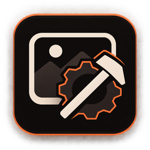
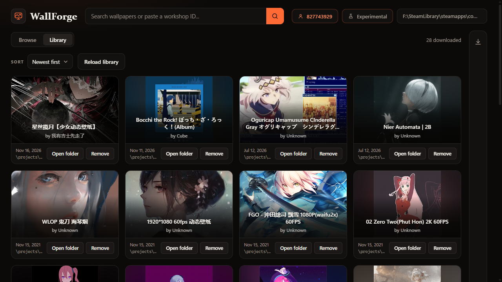
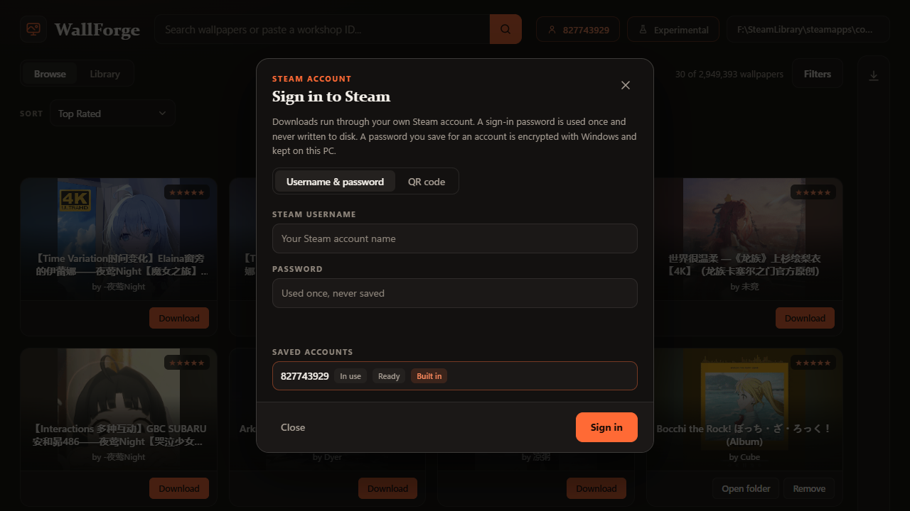

<div align="center">



# WallForge

**A desktop browser and downloader for the Wallpaper Engine Steam Workshop.**


</div>

WallForge searches the Steam Workshop the way Wallpaper Engine itself does, downloads what you pick straight into your library, and keeps track of what you already own. One window, no browser tabs, no Workshop links to copy, no manual unzipping.

## Screenshots

<p align="center">
  
  
</p>

<p align="center">
  
  
</p>

<p align="center">
  
  
</p>

## Features

| | |
|---|---|
| 🔍 **Workshop browsing** | Top rated, most popular (today/week/month/year), most recent, most up votes, and most subscriptions |
| 🎛️ **Official filters** | The same Workshop groups Wallpaper Engine uses: Miscellaneous, Type, Age Rating, Genre, Resolution, Category, Asset Type, Asset Genre, and Script Type |
| 🔎 **Search** | Search by keyword, or paste a Workshop ID to open that item directly |
| 🧾 **Wallpaper details** | Click any card for the creator, file size, resolution, genre, type, age rating, rating count, and description — the same facts the official app shows |
| 🔑 **Steam sign-in** | Sign in with your username and password, or scan a QR code with the Steam mobile app. Steam Guard codes are entered in the same dialog |
| 🧪 **Experimental anonymous downloads** | No account or API key: fetch a public manifest via a short-lived code, with automatic fallback to Steam |
| 📥 **One-click downloads** | Fetched with DepotDownloaderMod and saved into `projects\myprojects\<id>` — real progress, not a fake bar |
| 🗂️ **Library management** | Open a wallpaper's folder, remove it, and sort your library newest or oldest first |
| 📁 **Install detection** | Finds Wallpaper Engine through the registry and every Steam library, with a manual folder picker when detection misses |
| 💾 **Remembers your setup** | Install folder, window size, filter choices, download sort order, and your Steam username all survive a restart |
| 🖥️ **Comfortable window** | Opens at 1280×720, centred, DPI-aware, and never larger than your desktop |
| 🔒 **Local by design** | The React interface talks to the Rust core through Tauri commands — no local web server; a sign-in password is used once and never saved in plain text |

## Requirements

- **Windows 10 or 11 (64-bit)**
- **Wallpaper Engine** installed — Steam or a standalone copy both work
- **A Steam account** — sign in from the app with a password or QR code (optional if you use the experimental anonymous path)
- **.NET 9 runtime** for the bundled DepotDownloaderMod ([download](https://dotnet.microsoft.com/download/dotnet/9.0))
- **Rust 1.77+** and **Node 18+** only if you run or build from source
- WebView2 runtime (already installed on Windows 11 and most Windows 10 systems)

## Installation

### Portable executable (recommended)

1. Download `WallForge.exe` from [Releases](https://github.com/suprimacy/WallForge/releases)
2. Put it anywhere you like and run it — one file, nothing else to install
3. If SmartScreen warns about an unknown publisher, choose **More info → Run anyway** (the exe is unsigned)

The download tool travels inside the exe and is unpacked to `%LOCALAPPDATA%\WallForge\depot` the first time it runs, so there is no second file to carry around.

Settings and the WebView2 profile are created in `%APPDATA%\WallForge` on first launch.

### From source

```powershell
git clone https://github.com/suprimacy/WallForge.git
cd WallForge
build.ps1
```

`build.ps1` builds the interface with Vite, compiles the Rust core, and leaves the app in `webapp\src-tauri\target\release\wallforge.exe` next to the `DepotDownloaderMod` folder it needs.

To work on the interface, run the Vite dev server and let Tauri load it:

```powershell
cd webapp
npm install
npm run tauri dev
```

The Rust core lives in `webapp/src-tauri/src`, the interface in `webapp/src`. They talk over Tauri commands, so the interface never talks to a local web server.

### Layout

| Path | What it holds |
|---|---|
| `webapp/src-tauri/src` | The Rust core: Steam API, Workshop parsing, downloads, sign-in, and the library |
| `webapp/src` | The React interface |
| `docs` | Screenshots |

## Usage

### Browsing

The **Top** tab opens on the highest-rated wallpapers. Use **Sort by** to switch between Top Rated, Most Popular (Year, Month, Week, Today), Most Recent, Most Up Votes, and Most Subscriptions. Steam's website only exposes a subset of these rankings, so the two Steamworks-only sorts use the closest web equivalent.

**Filters** opens the official Workshop groups. Selections combine with **AND**, exactly like Steam, so adding more tags narrows the results. **Clear** resets them, and your choices are remembered next time. Long groups such as Genre scroll inside their own box, so you can read every tag without the panel growing, and **Show all** opens one group in full.

Use **Prev** / **Next** or type a page number — the controls appear above and below the results, with the total page and result counts coming from Steam.

### Searching

- Type a keyword and press **Enter**
- Paste a Workshop ID (for example `3309647577`) and press **Enter** to jump straight to that item

### Viewing wallpaper details

Click a wallpaper's thumbnail - or anywhere on its card - to open the details view. It shows the creator, rating and rating count, file size, resolution, genre, type, category, age rating, posting and update dates, extra Workshop tags, and the creator's description.

The preview uses the largest screenshot the Workshop page offers, so the details view stays sharp even when the card thumbnail is a small animated GIF.

- **Download** starts the download without leaving the dialog
- On items already in your library, **Open folder** and **Remove** appear instead
- Press **Esc**, click the dimmed background, or use **Close** to dismiss it
- If Steam throttles the request, the dialog says so and offers **Retry**

Details are read from the item's Workshop page each time it is opened.

### Signing in to Steam

Click **Sign in to Steam** next to the tabs. Downloads need a signed-in Steam account, so WallForge asks for one the first time you download.

- **Username & password** — enter your Steam account name and password, then press **Sign in**. The password is handed to DepotDownloaderMod once and is never written to disk in plain text.
- **QR code** — press **Show QR code**, scan it with the Steam mobile app, and approve the sign-in.

If Steam asks for a Steam Guard code, a code field appears in the dialog. Enter the code from your authenticator app or the email Steam sent, then press **Submit**. When the sign-in completes, the header shows the account name and downloads use it automatically.

Only usernames are remembered. The sign-in token is kept by DepotDownloaderMod on this PC, so you stay signed in across restarts until the token expires. The saved-accounts list lets you switch accounts or remove one. If a download reports that your session expired, open the dialog and sign in again.

#### Password-less downloads for one account

Some accounts have no Steam Guard, so DepotDownloaderMod can sign in with a plain password every time. WallForge keeps that password encrypted with Windows DPAPI, which only your Windows user on this PC can read, and feeds it to the download tool on stdin, so it never appears on a command line or in the repository. Downloads then answer the tool's password prompt on their own and never show a login prompt.

The encrypted value lives in `%APPDATA%\WallForge\settings.json`, outside the repository. Removing the account deletes it.

#### Sharing accounts with everyone

One shared account is built into the app: its password is encrypted with AES-GCM and stored as a seed in the source, so a fresh install is ready to download without any sign-in. On startup WallForge decrypts it and keeps it in the local encrypted store, and the account shows up in the picker marked **Ready**.

The encryption keeps the password out of plain sight in the repository. The key ships with the app, so it is not a secret from someone who unpacks the binary, and the account itself belongs to whoever runs the project. If Steam bans it, replace the seed with a new one.

You can also arm other accounts by hand: press **Password** next to any account in the saved-accounts list and WallForge stores that password encrypted with Windows DPAPI, which only your Windows user on this PC can read. The built-in account is marked **Built in** and cannot be changed or removed.

### Downloading

Click **Download** on a card and the wallpaper joins the queue in the sidebar. Downloads run one at a time, so a queue of wallpapers works through them in order. The sidebar runs the full height of the window and scrolls on its own, so the queue never pushes the results off screen. Close it with the arrow at the top of the panel, and reopen it from the tab on the right edge; the choice is remembered between launches.

Each entry in the queue shows its progress and can be **paused**, **resumed**, or **cancelled**. Pausing suspends the download where it is, and resuming picks it up from there. When a download finishes, the wallpaper is already in your Wallpaper Engine library — open Wallpaper Engine and it is there. Large wallpapers can take a few minutes; the transfer is aborted after 10 minutes. If no account is signed in, the sign-in dialog opens automatically.

A wallpaper that is already downloaded shows **Open folder** and **Remove** on its card, in the browse grid as well as in the library. If Windows refuses to open a folder, the app says so at the bottom of the window instead of doing nothing.

### Managing downloads

The **Library** tab lists everything in your library with its rating, author, and date added.

- **Sort by** switches between **Newest first** and **Oldest first** (remembered between launches)
- **Click a card** to see the same details view as in the Workshop, with **Open folder** and **Remove** actions
- **Open folder** reveals the files in Explorer
- **Remove** deletes the wallpaper from disk
- **Reload library** re-reads the folder if you changed something outside the app

Each wallpaper shows its own preview picture, the same one the Workshop shows. Wallpapers that were downloaded before this version had no picture saved, so the app asks Steam for those once and keeps the answer on disk.

### Changing the install folder

Click the install chip in the header.

- **Automatic** uses the folder registered by Wallpaper Engine, then the main Steam library, then any extra Steam libraries. If more than one is found, the list tells you which one is in use.
- **Manual** lets you browse for the folder or paste a path. It accepts the install root, its `projects` folder, or `projects\myprojects`, and is validated before saving.

A manual folder takes priority until you switch back to Automatic. If it is deleted later, WallForge quietly falls back to detection.

### Experimental: anonymous downloads

The **Experimental** chip in the header opens the panel for downloading without a Steam sign-in. It is off by default. No account and no API key are involved.

1. Turn on **Use anonymous manifests**.

The code service sees your IP and the manifest ID you request — nothing else. To send that one request through a proxy, set the standard `HTTPS_PROXY` environment variable before starting WallForge; wallpaper downloads always connect directly to Steam.

Each download resolves the workshop ID to its manifest ID through Steam's public details API, requests a short-lived code from a public service, fetches the manifest ZIP from a SteamPipe CDN node, and hands the raw manifest and a depot key to DepotDownloaderMod with `-ugc`. Network or rate-limit failures retry four times at 2/4/8 seconds across several CDN nodes. The manifest is cached in the wallpaper's own `<item>\.DepotDownloader` folder, so a cached item never contacts the code service again. If no manifest can be fetched, that download falls back to the signed-in Steam account.

## Settings and data

| What | Where |
|---|---|
| Steam usernames and install folder | `%APPDATA%\WallForge\settings.json` |
| A download password you chose to keep | `%APPDATA%\WallForge\settings.json`, encrypted with Windows DPAPI |
| Steam sign-in token | DepotDownloaderMod's per-user isolated storage (managed by the bundled backend, not stored by WallForge) |
| Anonymous download mode | `%APPDATA%\WallForge\settings.json` |
| Cached depot key | `%LOCALAPPDATA%\WallForge\431960.key` |
| Cached manifests | `<Wallpaper Engine>\projects\myprojects\<id>\.DepotDownloader` |
| Filter and sort choices | `%APPDATA%\WallForge\webview` (WebView2 profile) |
| Downloaded wallpapers | `<Wallpaper Engine>\projects\myprojects\<workshop id>` |

A password is only stored when you press **Password** next to an account, and then only as a DPAPI-encrypted blob that your Windows user alone can decrypt. Sign-in passwords typed into the sign-in form are never written to disk. Delete `%APPDATA%\WallForge` to reset the app's settings and web profile. Your wallpapers and the Steam token kept by DepotDownloaderMod are not touched.

## Building the executable

```powershell
.\build.ps1
```

The script installs the npm packages, builds the React interface with Vite, compiles the Rust core, and prints the path to `wallforge.exe`. It also checks that the embedded `DepotDownloaderMod` folder was extracted, since the download backend travels inside the exe and is unpacked on first run.

To build by hand:

```powershell
cd webapp
npm install
npm run build
cd src-tauri
cargo build --release
```

The app is then in `webapp\src-tauri\target\release`. For an installer, use `npm run tauri build` from `webapp` (the Tauri CLI is already a dev dependency).

Run the test suite with:

```powershell
cd webapp\src-tauri
cargo test
```

## Troubleshooting

| Problem | Fix |
|---|---|
| Wallpaper Engine is not detected | Click the install chip → **Manual** → pick the folder containing `wallpaper32.exe` / `wallpaper64.exe` |
| A download says the Steam session expired | Click **Sign in to Steam** and sign in again — DepotDownloaderMod's token is no longer valid |
| Steam asks for a Steam Guard code | Type it into the code field in the sign-in dialog and press **Submit** |
| The QR code expired before you scanned it | Press **Cancel sign-in**, then **Show QR code** again — Steam rotates the code every few minutes |
| "Steam is rate-limiting requests" | Steam throttled the Workshop pages. Wait a minute or two and search again |
| Details say they could not be loaded | Steam throttled the item page. Press **Retry** after a minute — WallForge falls back to Steam's Web API automatically |
| The window is too small or too large | Drag an edge or maximise it — the layout reflows to the window size. The app opens at 1280×720 by default |
| Nothing happens on launch | Install the [.NET 9 runtime](https://dotnet.microsoft.com/download/dotnet/9.0) and the WebView2 runtime, then try again |
| Antivirus flags the exe | The exe is unsigned and bundles a .NET download tool, which some scanners flag. Build from source if you prefer |

## Credits

WallForge is a standalone project built on the work of others. It is also **fully AI-assisted** — designed, implemented, and documented with AI.

- **[SteamAutoCracks/DepotDownloaderMod](https://github.com/SteamAutoCracks/DepotDownloaderMod)** — the download backend, licensed **GPL-2.0**. Its license is included at [`vendor/DepotDownloaderMod/LICENSE`](vendor/DepotDownloaderMod/LICENSE). DepotDownloaderMod is itself based on [SteamRE/DepotDownloader](https://github.com/SteamRE/DepotDownloader).
- **[SteamAutoCracks/ManifestHub](https://github.com/SteamAutoCracks/ManifestHub)** — the source of the public depot key used by the experimental anonymous download path.
- Wallpaper metadata and search results come from Steam's public Workshop pages and Web API.

## Disclaimer

WallForge is for personal use. Respect Steam's Terms of Service and the rights of wallpaper creators — downloaded items are for your own library, not for redistribution. WallForge is not affiliated with Valve, Steam, or Wallpaper Engine.

## License

The bundled DepotDownloaderMod binary remains under **GPL-2.0**, and its license ships with it in [`vendor/DepotDownloaderMod/LICENSE`](vendor/DepotDownloaderMod/LICENSE).
