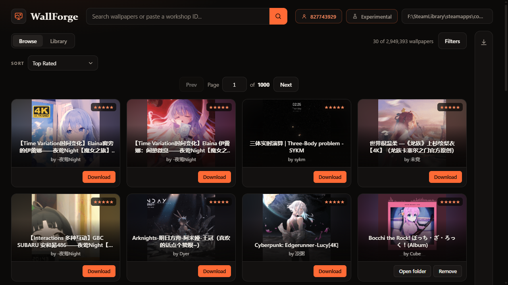
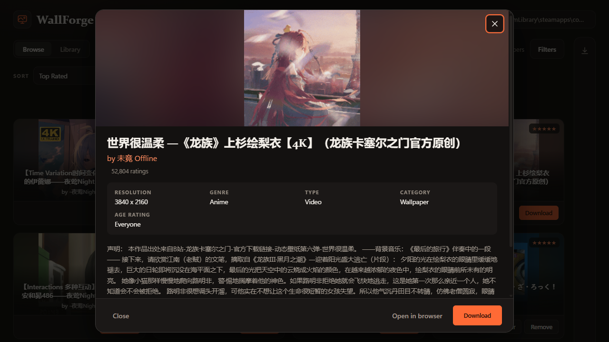
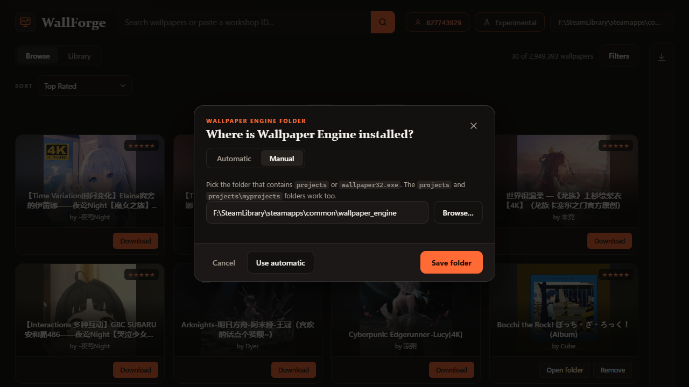
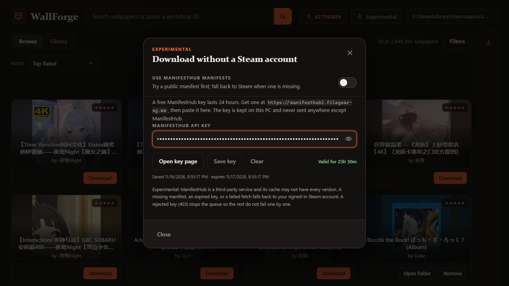

<div align="center">


# WallForge

**A desktop browser and downloader for the Wallpaper Engine Steam Workshop.**


</div>

WallForge searches the Steam Workshop the way Wallpaper Engine itself does, downloads what you pick straight into your library, and keeps track of what you already own. One window, no Workshop links to copy, no manual unzipping.

## Screenshots

<p align="center">
  
  
</p>

<p align="center">
  
  
</p>

<p align="center">
  
  
</p>

## Features

- **Workshop browsing** — Top Rated, Most Popular (Today, Week, Month, Year), Most Recent, Most Up Votes, Most Subscriptions.
- **Official filters** — the same groups Wallpaper Engine uses (Miscellaneous, Type, Age Rating, Genre, Resolution, Category, Asset Type, Asset Genre, Script Type), combined with AND like Steam.
- **Search** — by keyword, or paste a Workshop ID to open that item directly.
- **Wallpaper details** — creator, file size, resolution, genre, rating, dates, tags and description, read from the item's Workshop page.
- **Steam sign-in** — username and password or a QR code, with Steam Guard codes in the same dialog.
- **Anonymous downloads** — optional public-manifest path that needs no sign-in, falling back to Steam when a manifest is unavailable.
- **Library management** — open a wallpaper's folder, remove it, and sort newest or oldest first.
- **Install detection** — registry and every Steam library, with a manual folder picker when detection misses.
- **Remembers your setup** — install folder, filter choices, sort order and Steam usernames survive a restart.
- **Local by design** — React talks to Rust through Tauri commands, no local web server; a typed password is never saved in plain text.

## Requirements

- **Windows 10 or 11 (64-bit)**
- **Wallpaper Engine** installed — Steam or a standalone copy
- **.NET 9 runtime** for the bundled DepotDownloaderMod ([download](https://dotnet.microsoft.com/download/dotnet/9.0))
- **WebView2 runtime** — already installed on Windows 11 and most Windows 10 systems
- **Rust 1.77+** and **Node 18+** only when building from source

## Installation

### Portable executable (recommended)

1. Download `WallForge.exe` from [Releases](https://github.com/suprimacy/WallForge/releases).
2. Run it — one file, nothing else to install. The download tool travels inside the exe and is unpacked to `%APPDATA%\WallForge\depot` on first launch.
3. If SmartScreen warns about an unknown publisher, choose **More info → Run anyway**. The exe is unsigned.

### From source

```powershell
git clone https://github.com/suprimacy/WallForge.git
cd WallForge
build.ps1
```

`build.ps1` builds the interface with Vite, compiles the Rust core, and prints the path to `wallforge.exe`. For interface work, run `npm install` and then `npm run tauri dev` in `webapp`.

| Path | What it holds |
|---|---|
| `webapp/src-tauri/src` | Rust core: Steam API, Workshop parsing, downloads, sign-in, library |
| `webapp/src` | React interface |
| `docs` | Screenshots |

## Usage

**Browsing.** The **Browse** tab opens on Top Rated. **Sort by** switches between the rankings above. **Filters** opens the official Workshop groups; selections combine with AND like Steam, and your choices are remembered. **Prev** / **Next** or the page box sit above and below the grid, with the total page and result counts coming from Steam.

**Search.** Type a keyword and press **Enter**, or paste a Workshop ID (for example `3309647577`) to jump straight to that item.

**Details.** Click any card for the creator, rating, file size, resolution, genre, dates, tags and description, using the largest screenshot the Workshop offers. **Download** starts without leaving the dialog; items already in your library offer **Open folder** and **Remove** instead. Press **Esc** or click the dimmed background to close. If Steam throttles the request, the dialog says so and offers **Retry**.

**Steam sign-in.** Click **Sign in to Steam** next to the tabs and use a password or **Show QR code**. Steam Guard codes are entered in the same dialog. Only usernames are remembered; DepotDownloaderMod keeps the sign-in token on this PC. A password you choose to save with the **Password** button is encrypted with Windows DPAPI and never written in plain text. Some builds ship with a pre-armed shared account marked **Built in**, ready to download without signing in — its key ships with the app, so treat that account as shared, not secret.

**Downloading.** The queue lives in the sidebar and runs one download at a time; each entry can be paused, resumed or cancelled. A finished wallpaper is already in your Wallpaper Engine library. Transfers are aborted after 10 minutes. Close the sidebar with the arrow and reopen it from the tab on the right edge.

**Library.** The **Library** tab lists what you own with rating, author and date added. Sort newest or oldest, open a wallpaper's folder, remove it, or **Reload library** after changing something outside the app.

**Install folder.** The chip in the header shows the folder in use. **Automatic** tries the folder registered by Wallpaper Engine, then the main Steam library, then extra libraries. **Manual** accepts the install root, its `projects` folder, or `projects\myprojects`. A manual choice wins until you switch back to Automatic.

**Anonymous downloads (Experimental).** The **Experimental** chip toggles a no-sign-in path. WallForge asks Steam for the item's manifest ID, gets a short-lived code from a public service, fetches the manifest from a Steam CDN node, and runs DepotDownloaderMod with `-ugc` instead of `-pubfile`. Cached manifests need no service at all. If the manifest is unavailable, the download falls back to your Steam account; a rejected code stops the rest of the queue and asks you to try again. The service sees your IP and the manifest ID only. Set the standard `HTTPS_PROXY` / `HTTP_PROXY` environment variable before launching WallForge to hide your IP from that one request — wallpaper downloads always connect directly to Steam.

## Settings and data

Everything WallForge owns lives in `%APPDATA%\WallForge`, except cached manifests, which stay with the wallpaper they belong to.

| What | Where |
|---|---|
| Steam usernames and install folder | `%APPDATA%\WallForge\settings.json` |
| A download password you chose to keep | `%APPDATA%\WallForge\settings.json`, encrypted with Windows DPAPI |
| Anonymous download mode | `%APPDATA%\WallForge\settings.json` |
| Download tool | `%APPDATA%\WallForge\depot` (unpacked from the exe on first run) |
| Cached depot key | `%APPDATA%\WallForge\431960.key` |
| Filter and sort choices | `%APPDATA%\WallForge\webview` (WebView2 profile) |
| Steam sign-in token | DepotDownloaderMod's per-user isolated storage, not stored by WallForge |
| Cached manifests | `<Wallpaper Engine>\projects\myprojects\<id>\.DepotDownloader` |
| Downloaded wallpapers | `<Wallpaper Engine>\projects\myprojects\<workshop id>` |

A password is only stored when you press **Password** next to an account, and then only as a DPAPI blob that your Windows user alone can decrypt. Delete `%APPDATA%\WallForge` to reset the app's settings and web profile; your wallpapers and the Steam token are untouched.

## Building

```powershell
.\build.ps1
```

To build by hand, run `npm install`, `npm run build` and `cargo build --release` in `webapp`. For an installer, use `npm run tauri build`. Run the test suite with `cargo test` in `webapp\src-tauri`.

## Troubleshooting

| Problem | Fix |
|---|---|
| Wallpaper Engine is not detected | Click the install chip → **Manual** → pick the folder containing `wallpaper32.exe` / `wallpaper64.exe` |
| A download says the Steam session expired | Click **Sign in to Steam** and sign in again |
| Steam asks for a Steam Guard code | Type it into the code field and press **Submit** |
| The QR code expired before you scanned it | Press **Cancel sign-in**, then **Show QR code** again |
| "Steam is rate-limiting requests" | Wait a minute or two and search again |
| Details say they could not be loaded | Press **Retry** after a minute; WallForge falls back to the Web API automatically |
| Nothing happens on launch | Install the [.NET 9 runtime](https://dotnet.microsoft.com/download/dotnet/9.0) and the WebView2 runtime |
| Antivirus flags the exe | It is unsigned and bundles a .NET download tool, which some scanners flag. Build from source if you prefer |

## Credits

WallForge is a standalone project built on the work of others:

- **[SteamAutoCracks/DepotDownloaderMod](https://github.com/SteamAutoCracks/DepotDownloaderMod)** — the download backend, licensed **GPL-2.0**. Its license is included at [`vendor/DepotDownloaderMod/LICENSE`](vendor/DepotDownloaderMod/LICENSE). It is itself based on [SteamRE/DepotDownloader](https://github.com/SteamRE/DepotDownloader).
- Wallpaper metadata and search results come from Steam's public Workshop pages and Web API.

## Disclaimer

WallForge is for personal use. Respect Steam's Terms of Service and the rights of wallpaper creators — downloaded items are for your own library, not for redistribution. WallForge is not affiliated with Valve, Steam, or Wallpaper Engine.

## License

The bundled DepotDownloaderMod binary remains under **GPL-2.0**, and its license ships with it in [`vendor/DepotDownloaderMod/LICENSE`](vendor/DepotDownloaderMod/LICENSE).
